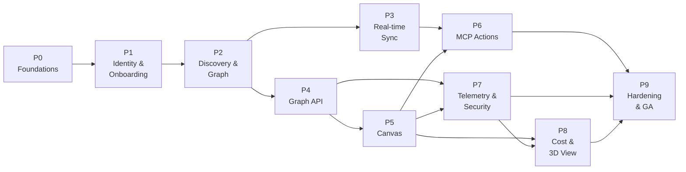

# Argus Engine — Phased Implementation Plan

> **Status:** Draft for review  
> **Source architecture:** [`ARGUS_ENGINE_HIGH_LEVEL_SYSTEM_ARCHITECTURE.md`](../../ARGUS_ENGINE_HIGH_LEVEL_SYSTEM_ARCHITECTURE.md)  
> **Last updated:** 2026-11-10

This directory converts the high-level architecture into an executable delivery plan: phases, workstreams, concrete tasks, interface contracts, exit gates, test strategy, and the operational model needed to run the product.

---

## 1. What we are building

Argus Engine is a multi-tenant, multi-account, multi-region AWS management console with four product pillars:

1. **Discover** — continuously inventory AWS resources across accounts and regions.
2. **Visualize** — render a live, interactive graph of infrastructure topology.
3. **Act** — perform safe, reviewed AWS mutations directly from the canvas through an MCP-based action engine.
4. **Observe** — overlay live telemetry, security exposure, and cost intelligence on the same graph.

The architecture is event-driven and graph-native:

- **Discovery truth** lives in Neo4j as a tenant-scoped resource graph.
- **Change freshness** comes from AWS Config, EventBridge, and CloudTrail, with periodic reconciliation as the safety net.
- **Read APIs** serve viewport-scoped topology slices to the canvas.
- **Writes** are never autonomous: every mutation becomes a plan, a diff, an approval, an execution, and a verification.
- **PostgreSQL** stores tenancy, identity, job state, audit, approvals, findings, and cost aggregates.

---

## 2. Planning assumptions

| Assumption | Value |
|---|---|
| Starting point | Greenfield build; no existing application code |
| Cloud scope | AWS only for v1; no Azure/GCP/on-prem |
| Tenancy | Tenant = customer organization; one tenant can connect many AWS accounts and regions |
| Deployment | Single primary SaaS region for control plane at launch; multi-region hardening in Phase 9 |
| Customer footprint | Teams managing 10–500 AWS accounts, 10k–100k resources per tenant |
| Team | 8–10 FTE: 2 frontend, 3 backend, 1 platform/SRE, 1 security (shared), 1 data/ML (from Phase 6), PM + design |
| Timeline | ~14 months from kickoff to GA, with parallel workstreams; 4-week hypercare |
| Compliance target | SOC 2 Type II readiness by GA; certification not required to launch |
| Commercial model | Not decided in this plan; billing hooks are stubbed in Phase 9 |

If any assumption changes materially (especially team size or compliance target), re-baseline the phase durations and the critical path.

---

## 3. Delivery principles

1. **Read before write.** Ship a trustworthy read-only topology before enabling any mutation.
2. **Deterministic safety over model autonomy.** LLMs may interpret intent and explain plans; they never emit unvalidated policies or execute writes directly.
3. **Tenant isolation is an invariant, not a feature.** Every storage, cache, queue, graph query, log, and MCP session is tenant-scoped and tested for leakage.
4. **Events for freshness, reconciliation for truth.** Events can be lost, duplicated, or reordered; periodic full sync is mandatory.
5. **Idempotency everywhere.** Every ingest, sync, plan, approval, and execution carries an idempotency key.
6. **Contract-first.** OpenAPI, event schemas, and MCP tool schemas are versioned and tested before implementation.
7. **Progressive disclosure.** The canvas loads only what is visible or one interaction away; the backend serves viewport-scoped slices, not whole graphs.
8. **Short-lived credentials only.** No long-lived AWS keys. STS sessions are scoped, tagged, cached, and audited.
9. **Observable by default.** Every service emits traces, RED/USE metrics, structured logs, and audit events.
10. **Feature flags for risk.** Live updates, 3D view, telemetry, and mutation actions ship behind flags with safe fallbacks.

---

## 4. Phase map

| Phase | Name | Release | Duration | Depends on | Primary outcome |
|---|---|---|---|---|---|
| **0** | Foundations, Decisions & Delivery Spine | R0 | 3–4 weeks | — | Repo, environments, CI/CD, ADRs, threat model, conventions |
| **1** | Identity, Tenancy & AWS Account Onboarding | R0 | 5–6 weeks | P0 | Tenants, SSO, RBAC, secure cross-account role assumption, audit |
| **2** | Discovery Pipeline & Resource Graph | R1 | 7–8 weeks | P1 | Initial inventory of supported AWS resources in Neo4j |
| **3** | Real-Time Event Synchronization | R2 | 5–6 weeks | P2 | Sub-minute graph freshness and live WebSocket deltas |
| **4** | Graph Query API & Aggregation Layer | R1 | 4–5 weeks | P2 | Stable, cached, tenant-safe read API for the canvas |
| **5** | Visual Canvas Frontend | R1/R2 | 7–8 weeks | P4 | Interactive nested topology canvas with inspector and live mode |
| **6** | MCP Action Engine & Safe Mutations | R2 | 9–10 weeks | P5, P3 | Reviewed plan/diff/approve/apply/verify mutations |
| **7** | Live Telemetry & Security Intelligence | R3 | 5–6 weeks | P4, P5 | CloudWatch overlays, findings, attack-path visualization |
| **8** | Cost Intelligence & 3D Macro View | R3 | 4–5 weeks | P5, P7 | Cost overlays, optimization recommendations, 3D account view |
| **9** | Hardening, Scale & GA | R4 | 7–8 weeks | All | Production readiness, DR, pen test, GA launch |

### Dependency graph

### Release definitions

| Release | Name | Phases | Demo / exit statement |
|---|---|---|---|
| **R0** | Platform Foundation | P0, P1 | A tenant can sign in, invite users, connect an AWS account, and pass isolation tests. |
| **R1** | Read-Only Topology | P2, P4, P5 | A user can explore a real multi-account AWS topology on the canvas with search, nesting, and inspector. |
| **R2** | Live & Actionable | P3, P6 | Changes appear within seconds; six golden mutations work end-to-end with plan, diff, approval, rollback, and audit. |
| **R3** | Intelligence | P7, P8 | Metrics, security findings, attack paths, cost overlays, and the 3D macro view are available behind flags. |
| **R4** | GA | P9 | Scale, DR, security, operability, and support targets are met; GA sign-off. |

---

## 5. Baseline technology decisions

These are the recommended defaults for Phase 0 ratification. Alternatives and consequences are recorded in [`cross-cutting/decision-log.md`](cross-cutting/decision-log.md).

| Layer | Default choice | Why |
|---|---|---|
| Frontend | Next.js (App Router) + React 19 + TypeScript, React Flow, ELK.js, TanStack Query, Zustand, Tailwind + shadcn/ui | SSR for admin surfaces, mature graph canvas, strong typing, clear client/server state split |
| Backend | FastAPI + Python 3.12, Pydantic v2, SQLAlchemy 2, Alembic | Native boto3, MCP Python SDK, async I/O, fast iteration for data-heavy services |
| Graph database | Neo4j 5 (AuraDB managed in production, Docker locally) | Cypher, recursive traversals, mature graph tooling |
| Relational database | Aurora PostgreSQL 16 | Tenancy, audit, jobs, approvals, findings, cost aggregates, RLS |
| Cache / fanout | ElastiCache Redis 7 | Query cache, rate limits, WebSocket pub/sub, dedupe |
| Event backbone | AWS Config + EventBridge + SQS (DLQ) + CloudTrail; EventBridge Scheduler for reconciliation | Native AWS change signals with replay and buffering |
| Identity | OIDC (Cognito or Keycloak in dev) with corporate IdP federation; Next.js BFF; RBAC + ABAC scopes | Standards-based SSO, no tokens in browser storage |
| Cross-account access | STS AssumeRole with per-tenant external ID, session tags, optional write role + permission boundary | Secretless, auditable, revocable |
| AWS MCP runtime | Python MCP host + pinned AWS MCP servers in sandboxed ECS tasks | Isolated tool execution with scoped credentials |
| LLM | Amazon Bedrock behind a provider abstraction; deterministic plan generation | Tenant data stays in AWS; model output is never trusted for writes |
| IaC (platform) | Terraform modules, one state per environment/account | Broad AWS coverage, reviewable plans |
| IaC (customer mutations) | AWS CDK constructs + CloudFormation change sets | Deterministic diffs and native change preview |
| Compute | ECS Fargate + ALB + CloudFront | Simple operations, good fit for API/worker/WebSocket services |
| Observability | OpenTelemetry, CloudWatch/Grafana, Sentry, PagerDuty | Correlated traces, metrics, logs, and alerting |
| CI/CD | GitHub Actions, OIDC to AWS, signed images, SBOM | Standard, auditable supply chain |

**Decision gates:** If the organization is AWS-native and prefers managed services, substitute Neptune for Neo4j, Cognito for the IdP, and API Gateway where appropriate. Each substitution changes the phase plan; record it as an ADR before Phase 1.

---

## 6. Workstreams

The phase plans are organized into recurring workstreams so ownership is stable across phases.

| Workstream | Scope | Primary roles |
|---|---|---|
| **WS-PLAT** | Environments, IaC, CI/CD, networking, observability, SRE | Platform/SRE |
| **WS-ID** | AuthN, tenancy, RBAC, account onboarding, STS broker, audit | Backend + Security |
| **WS-DISC** | Resource catalog, AWS discovery, graph ingestion, reconciliation | Backend + Data |
| **WS-EVT** | Config/EventBridge/CloudTrail ingestion, delta processing, replay | Backend + Platform |
| **WS-GAPI** | Graph query API, caching, search, snapshots, contracts | Backend |
| **WS-FE** | Canvas, layout, inspector, search, live updates, design system | Frontend + Design |
| **WS-MCP** | MCP host, tool catalog, plan/diff, approvals, execution, guardrails | Backend + Security + ML |
| **WS-OBS** | Metrics pipeline, findings, attack paths, cost, 3D overlays | Backend + Frontend + Security |
| **WS-QA** | Test strategy, automation, performance, chaos, release gates | QA + all |

---

## 7. How each phase document is structured

Every phase plan follows the same shape:

1. **Objective** — the single outcome the phase must produce.
2. **Architecture mapping** — which architecture components the phase realizes.
3. **Scope** — explicit in/out of scope.
4. **Workstreams and tasks** — IDs, outputs, sizes, owners, dependencies.
5. **Deliverables** — reviewable artifacts, not just code.
6. **Interfaces and contracts** — APIs, events, schemas, or UI contracts introduced.
7. **Data and schema changes** — migrations and retention implications.
8. **Exit gate / acceptance criteria** — measurable and binary.
9. **Test and validation plan** — what proves the gate.
10. **Risks and mitigations** — linked to the risk register.
11. **Metrics** — what we watch after the phase ships.
12. **Handoff** — what the next phase can assume.

Sizes are t-shirt estimates for a single engineer: **S** = 1–3 days, **M** = ~1 week, **L** = 2–3 weeks, **XL** = 4+ weeks (must be split before sprint planning).

---

## 8. Program-level definition of done

A phase is done only when all of the following are true:

- Acceptance criteria in the phase document are met and demonstrated.
- Code is reviewed, typed, tested, and merged to `main`.
- API/event/MCP contracts are versioned and published.
- Migrations are reversible and tested against a production-like dataset.
- Tenant isolation tests pass for every new storage or query path.
- Security review is complete for new trust boundaries, credentials, or write paths.
- Dashboards, alerts, and runbooks exist for new operational surfaces.
- Feature flags and rollback procedures are documented.
- User-facing behavior is covered by E2E tests and accessibility checks.
- Documentation and demo recording are published.
- The next phase's entry criteria are confirmed.

---

## 9. Explicitly out of scope for v1

- Fully autonomous remediation without human approval.
- Terraform state management or Terraform-based customer mutations.
- Multi-cloud (Azure/GCP) discovery or actions.
- On-premises or air-gapped deployment.
- A general-purpose IaC IDE.
- Mobile native applications.
- Full FinOps CUR/Athena pipeline (Phase 8 covers Cost Explorer-based intelligence; CUR is a later enhancement).
- Custom customer-authored security rules (curated rule catalog in Phase 7; custom rules later).
- Billing and subscription management (hooks only in Phase 9).

---

## 10. First two weeks

1. Ratify ADR-001 through ADR-012 and assign owners.
2. Stand up the monorepo, local Docker stack, and CI skeleton.
3. Provision AWS dev/staging accounts through Control Tower with baseline SCPs.
4. Run the threat-model workshop and publish the tenant-isolation checklist.
5. Publish API, event, and error conventions.
6. Spike the riskiest integrations in parallel:
   - STS AssumeRole + CloudFormation onboarding template against a sandbox account.
   - Neo4j bulk ingest + 3-hop topology query at 100k nodes.
   - AWS MCP server + CDK synth/diff in a sandbox for one golden action.
   - React Flow nested containers + ELK layout at 5k nodes.
7. Convert phase plans into epics and the first two sprints of tickets.
8. Schedule the Phase 0 gate review.

---

## 11. Document index

| Document | Purpose |
|---|---|
| [`phase-0-foundations.md`](phase-0-foundations.md) | Decisions, repo, environments, CI/CD, security/observability baseline |
| [`phase-1-identity-and-onboarding.md`](phase-1-identity-and-onboarding.md) | OIDC, tenancy, RBAC, account onboarding, STS broker, audit |
| [`phase-2-discovery-and-graph.md`](phase-2-discovery-and-graph.md) | Resource catalog, Resource Explorer/API discovery, Neo4j graph, reconciliation |
| [`phase-3-realtime-sync.md`](phase-3-realtime-sync.md) | Config/EventBridge/CloudTrail pipeline, delta processing, WebSocket gateway |
| [`phase-4-graph-api.md`](phase-4-graph-api.md) | Read API, topology queries, search, caching, snapshots |
| [`phase-5-canvas-frontend.md`](phase-5-canvas-frontend.md) | React Flow canvas, nested layout, inspector, live updates, performance |
| [`phase-6-mcp-action-engine.md`](phase-6-mcp-action-engine.md) | MCP host, deterministic plans, diff preview, approvals, execution, guardrails |
| [`phase-7-telemetry-and-security.md`](phase-7-telemetry-and-security.md) | CloudWatch metrics, findings engine, attack paths, overlays |
| [`phase-8-cost-and-macro-view.md`](phase-8-cost-and-macro-view.md) | Cost Explorer intelligence, optimization, 3D macro view |
| [`phase-9-hardening-and-ga.md`](phase-9-hardening-and-ga.md) | Scale, DR, security hardening, operability, GA |
| [`cross-cutting/domain-model.md`](cross-cutting/domain-model.md) | Tenancy, relational schema, graph schema, event envelope, IDs, retention |
| [`cross-cutting/security-architecture.md`](cross-cutting/security-architecture.md) | Trust boundaries, authN/Z, STS, tenant isolation, MCP/LLM safety, audit |
| [`cross-cutting/testing-strategy.md`](cross-cutting/testing-strategy.md) | Test pyramid, environments, contract/performance/security testing, gates |
| [`cross-cutting/observability-and-sre.md`](cross-cutting/observability-and-sre.md) | SLIs/SLOs, dashboards, alerts, capacity, runbooks |
| [`cross-cutting/delivery-roadmap.md`](cross-cutting/delivery-roadmap.md) | Team, timeline, milestones, dependencies, cost drivers, cadence |
| [`cross-cutting/risk-register.md`](cross-cutting/risk-register.md) | Scored risks with mitigations and owners |
| [`cross-cutting/decision-log.md`](cross-cutting/decision-log.md) | ADR-001 through ADR-012 with alternatives and revisit triggers |
