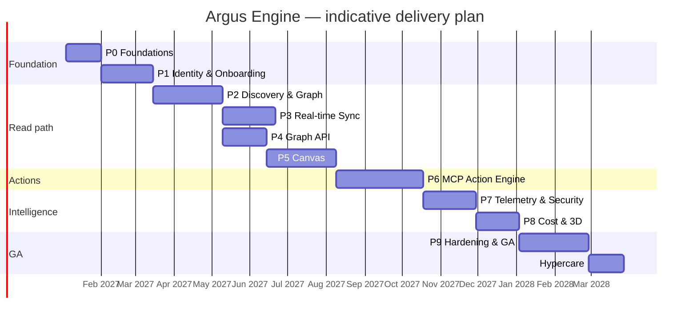
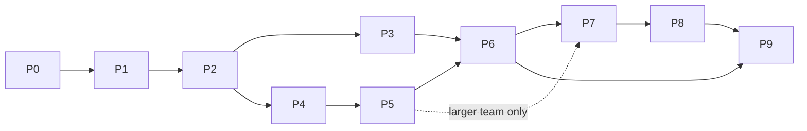

# Cross-Cutting — Delivery Roadmap

> **Applies to:** Program-wide  
> **Purpose:** Translate the phase plans into a realistic schedule, team shape, milestones, dependencies, cost drivers, and governance cadence.

---

## 1. Planning baseline

| Parameter | Assumption |
|---|---|
| Start | First full week after approval (placeholder: 2027-01-04) |
| Duration | ~14 months to GA, including holidays and contingency; 4-week hypercare |
| Team | 8–10 FTE core, plus external pen test and design partners |
| Working model | Two-week sprints, trunk-based development, feature flags |
| Critical path | P0 → P1 → P2 → P4 → P5 → P6 → P9 |
| Parallel tracks | P3 after P2; P7/P8 after P5 |

Rebaseline at kickoff and at every phase gate. Durations are estimates, not commitments.

---

## 2. Timeline

**Critical path:** 4 + 6 + 8 + 5 + 8 + 10 + 6 + 5 + 8 = **60 weeks** plus holidays/contingency (~14 months to GA). P6, P7, and P8 are sequenced for an 8–10 FTE team; parallelizing them requires more engineers. Protect the critical path by freezing scope at each gate.

---

## 3. Milestones

| Milestone | Phase | Target | Exit statement |
|---|---|---|---|
| **M0 — Delivery spine ready** | P0 | Week 4 | Local stack, CI/CD, ADRs, threat model, conventions |
| **M1 — Secure tenancy** | P1 | Week 10 | Tenant onboarding, SSO, RBAC, STS, audit, isolation tests |
| **M2 — Graph populated** | P2 | Week 18 | Real AWS inventory queryable; reconciliation stable |
| **M3 — Read-only topology (R1)** | P5 | Week 31 | Canvas explores real multi-account topology; 5k-node performance |
| **M4 — Live & actionable (R2)** | P6 | Week 41 | Live updates; six golden actions with approval, rollback, audit |
| **M5 — Intelligence (R3)** | P8 | Week 52 | Metrics, findings, attack paths, cost, 3D behind flags |
| **M6 — GA (R4)** | P9 | Week 60 | Scale, DR, pen test, operability, design partners, GA sign-off |
| **M7 — Hypercare complete** | — | Week 64 | 30-day post-launch review; SLOs stable; roadmap updated |

Milestone reviews are formal gates. A milestone slips if any acceptance criterion is unmet; do not carry unmet criteria into the next phase without an explicit risk acceptance.

---

## 4. Team shape

### Core roles

| Role | FTE | Responsibilities |
|---|---|---|
| Product manager | 1 | Scope, priorities, acceptance, design partners |
| Tech lead / architect | 1 | ADRs, cross-cutting design, code review, gate sign-off |
| Frontend engineers | 2–3 | Canvas, app shell, overlays, accessibility, performance |
| Backend engineers | 3 | Identity, discovery, API, events, actions |
| Platform/SRE | 1–2 | AWS, IaC, CI/CD, observability, reliability, DR |
| Security engineer | 1 (shared) | Threat model, isolation, IAM, MCP/LLM safety, pen-test coordination |
| Data/ML engineer | 1 (from P2/P6) | Graph modeling, allocation, LLM evaluation |
| Product designer | 1 (part-time) | Canvas UX, design system, usability |
| QA / SDET | 1 | Automation, environments, performance, release gates |
| Technical writer | 0.5 (from P5) | Admin/user/API docs |

### Peak allocation by phase (FTE)

| Phase | FE | BE | Platform | Security | Data/ML | Design | QA | Total |
|---|---|---|---|---|---|---|---|---|
| P0 | 1 | 2 | 2 | 1 | — | 0.5 | 0.5 | ~7 |
| P1 | 1 | 2 | 1 | 1 | — | 0.5 | 0.5 | ~6 |
| P2 | 0.5 | 3 | 1 | 0.5 | 1 | — | 1 | ~7 |
| P3 | — | 2 | 1 | 0.5 | 1 | — | 1 | ~5.5 |
| P4 | 1 | 2 | 0.5 | 0.5 | — | — | 1 | ~5 |
| P5 | 3 | 1 | 0.5 | 0.5 | — | 1 | 1 | ~7 |
| P6 | 2 | 3 | 1 | 1 | 1 | 0.5 | 1 | ~9.5 |
| P7 | 2 | 2 | 0.5 | 1 | 1 | 0.5 | 1 | ~8 |
| P8 | 2 | 1 | 0.5 | 0.5 | 1 | 0.5 | 1 | ~6.5 |
| P9 | 1 | 2 | 2 | 1 | 0.5 | 0.5 | 1 | ~8 |

Peak load in P6 (~9.5 FTE) is the highest-risk staffing point. If the team is smaller, extend P6 and P7 rather than compressing safety work.

---

## 5. Dependencies and critical path

**Resource-leveled sequence:** P6 → P7 → P8 → P9. The dashed edge is technically possible but not staffed in the baseline plan; it requires additional frontend/backend/security capacity.

### External dependencies

| Dependency | Needed by | Risk | Mitigation |
|---|---|---|---|
| AWS sandbox accounts | P1 | Provisioning delays | Request on day 1; use temporary accounts |
| Control Tower / Organizations access | P1 | Customer-specific | Support manual onboarding first |
| Cognito/IdP decision | P1 | Procurement/security review | Keycloak fallback for dev; decide in P0 |
| Neo4j Aura contract | P2 | Procurement | Self-hosted Neo4j for staging; decide in P0 |
| React Flow Pro license | P5 | Budget/legal | Evaluate MIT core first; Pro for support/examples |
| Bedrock model access | P6 | Quota approval | Request early; provider abstraction |
| MCP server maturity | P6 | Breaking changes | Pin versions; wrap adapters; direct SDK fallback |
| External pen test | P9 | Scheduling | Book at start of P8 |
| Design partners | P9 | Recruitment | Start conversations in P5 |
| SOC 2 auditor (post-GA) | P9 | Readiness only | Gap assessment; no certification dependency |

---

## 6. Cost drivers and guardrails

Order-of-magnitude monthly run rate at early scale (10 design partners, ~5M total graph nodes). Validate with the AWS pricing calculator; do not treat as a budget.

| Driver | Early-scale estimate | Guardrail |
|---|---|---|
| ECS Fargate (API, workers, WS, MCP) | $3k–8k | Right-size tasks; autoscaling; spot for workers where safe |
| Aurora PostgreSQL | $1.5k–5k | Serverless v2 scaling; connection pooling; retention |
| Neo4j Aura / self-hosted | $3k–15k | Right-size memory; dedicated DB only for large tenants |
| ElastiCache Redis | $0.5k–2k | Eviction policy; shard by tenant if needed |
| CloudWatch (metrics, logs) | $1k–10k | Viewport-only metrics; batching; log retention |
| Bedrock | $0.5k–5k | Token budgets; model routing; caching |
| S3 + data transfer | $0.5k–3k | Lifecycle policies; compression; CloudFront |
| Observability/Sentry | $0.5k–2k | Sampling; retention; cardinality control |
| **Total** | **~$10k–50k/month** | Per-tenant unit economics; quota alerts |

Commercial guardrails:

- Define a target gross margin before GA.
- Meter resources, events, metric requests, actions, and storage per tenant.
- Set soft and hard quotas; alert at 80%/100%.
- Review unit economics monthly from P7 onward.
- Price dedicated Neo4j databases and premium security features separately if offered.

---

## 7. Governance cadence

| Cadence | Meeting | Purpose | Owner |
|---|---|---|---|
| Daily | Standup | Progress, blockers, coordination | Tech Lead |
| Weekly | Demo + risk review | Show working software; update risks | PM + Tech Lead |
| Biweekly | Sprint planning | Commit scope; refine backlog | PM |
| Biweekly | Architecture review | ADRs, cross-cutting changes | Tech Lead |
| Monthly | Steering committee | Budget, timeline, scope, risks | Sponsor |
| Phase gate | Gate review | Acceptance criteria, demo, sign-off | Sponsor + Tech Lead |
| Quarterly | Access review | IAM, DB roles, admin access | Security |
| Quarterly | DR/chaos exercise | Failover, restore, incident drill | Platform |

### Change control

- Scope changes require a written impact assessment (time, cost, risk).
- Critical-path changes require steering approval.
- ADR changes require Tech Lead + Security sign-off.
- Phase gate criteria cannot be waived without documented risk acceptance.

---

## 8. RACI

| Area | Accountable | Responsible | Consulted | Informed |
|---|---|---|---|---|
| Architecture & ADRs | Tech Lead | Platform + Backend | Security, Product | Sponsor |
| Tenancy & auth | Security | Backend | Platform, Product | All |
| Discovery & graph | Tech Lead | Backend + Data | Security | Product |
| Realtime & API | Tech Lead | Backend | Platform | Frontend |
| Canvas & UX | Product | Frontend + Design | Backend, Security | All |
| MCP & actions | Security | Backend + ML | Platform, Product | Sponsor |
| Telemetry & security | Security | Backend + Frontend | Product | All |
| Cost & 3D | Product | Backend + Frontend + Data | Finance | Sponsor |
| Reliability & DR | Platform | Platform + Backend | Security | All |
| Release & GA | Tech Lead | Platform + QA | Product, Security, Legal | Sponsor |
| Compliance | Security | Security + Legal | Platform, Product | Sponsor |

---

## 9. Phase gate checklist

Before starting the next phase:

- [ ] All acceptance criteria met or explicitly risk-accepted.
- [ ] Demo completed with real (sandbox) data.
- [ ] Test suite green; no critical/high security findings.
- [ ] Documentation updated.
- [ ] Runbooks and dashboards for new surfaces.
- [ ] Risks updated and owners assigned.
- [ ] Next phase epics estimated and dependencies confirmed.
- [ ] Team capacity confirmed for the next phase.
- [ ] Sponsor sign-off recorded.

---

## 10. Contingency

| Scenario | Response |
|---|---|
| 2-week slip in P2 | Absorb with P3/P4 parallelization; protect P5 start |
| 4-week slip in P6 | Reduce golden actions from six to four; defer imperative actions; protect safety |
| Key engineer unavailable | Pair on critical modules; document ADRs; avoid single-owner components |
| AWS sandbox delays | Use temporary accounts; mock non-critical paths; defer authoritative tests |
| Neo4j scale issues | Reduce supported resource types; add read replica; defer dedicated DB |
| Security finding blocks launch | Stop feature work; fix; re-test; extend timeline rather than accept risk |
| Design partner recruitment slow | Launch with internal tenants; postpone GA marketing, not engineering gates |
